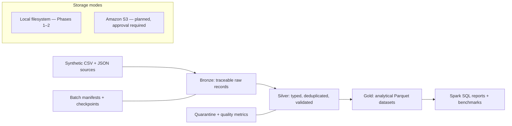

# Distributed E-Commerce Analytics Data Lake

> Portfolio project status: **Phases 1–2 implemented and locally verified**. All generated records
> are synthetic. AWS deployment, Silver/Gold processing, and performance claims remain explicitly
> unimplemented until their respective phases are tested.

A local-first data lake project for a fictional multi-region e-commerce company. It is designed
to demonstrate PySpark execution, explicit schemas, Parquet output, deterministic source data,
and eventually incremental medallion processing on local storage or Amazon S3.

## Architecture



The laptop path uses Spark `local[2]`. It exercises the same DataFrame planner, lazy execution,
task partitioning, and columnar I/O model used by a cluster, but it is **not evidence of
multi-node scalability**.

## Why this is not another PostgreSQL ETL pipeline

This project treats object storage and partitioned files as the analytical system of record.
Transformations are expressed as Spark DataFrame/Spark SQL plans that can be divided into tasks,
rather than loading rows into a single database process. The roadmap emphasizes shuffle-aware
joins, predicate pushdown, partition pruning, file sizing, late data, and repeatable batch commits.
PostgreSQL is intentionally not an analytical destination.

## Verified scope

| Capability | Status | Evidence |
|---|---|---|
| Reproducible Docker environment | Implemented, tested locally | `make doctor` |
| Deterministic synthetic data | Implemented, tested locally | unit tests + SHA-256 manifest |
| CSV and newline-delimited JSON sources | Implemented | generator output |
| Explicit Spark source schemas | Implemented | `ingestion/schemas.py` |
| First Spark job and Snappy Parquet output | Implemented, tested locally | integration test + `make run-local` |
| Immutable Bronze ingestion | Implemented, tested locally | integration test + `make run-bronze` |
| Malformed capture and source provenance | Implemented, tested locally | corrupt-record fixture + batch metadata |
| Silver validation/quarantine | Planned for Phase 3 | not claimed |
| Gold analytics/Spark SQL | Planned for Phase 4 | not claimed |
| Performance benchmarks | Planned for Phase 5 | no invented results |
| Incremental reliability | Planned for Phase 6 | not claimed |
| AWS S3/Glue/Athena/EMR | Planned, requires approval | no AWS resources created |

## Pinned compatibility baseline

| Component | Version | Rationale |
|---|---:|---|
| Python | 3.11.14 | Conservative, broadly supported runtime; host Python 3.14 is not used |
| Java | 17.0.20.1 | Tested LTS JVM package supported by Spark 3.5 |
| PySpark / Spark | 3.5.9 | Mature Spark 3 maintenance line |
| Hadoop client | 3.3 family | Bundled by the default PySpark 3.5.9 distribution |
| Boto3 | 1.43.116 | Pinned AWS SDK dependency; no credentials needed locally |
| Docker | Engine 24+ / Compose 2+ | Multi-platform local runtime; newer versions are compatible |

The S3A connector is intentionally not installed in Phase 1. `hadoop-aws` and its AWS SDK must
match Spark's bundled Hadoop libraries; those exact JARs will be pinned and tested when AWS mode
is approved. Adding them early would make a local-only phase slower and create an unverified
classpath.

## Quick start

Prerequisite: Docker Desktop with Compose. No host Java, Spark, Python 3.11, or AWS credentials
are required.

```bash
cp .env.example .env
make setup
make doctor
make generate-small
make run-local
make run-bronze
make test
```

Generated input is written to `data/raw/synthetic/small/` in the persistent Docker volume; the
smoke job writes event counts as Snappy-compressed Parquet under
`data/phase1/smoke/event_counts/`. Bronze writes immutable batches under `data/lake/bronze/`.
`make clean` removes only project-generated raw, Phase 1, and lake prefixes, while `make down`
tears down Compose without deleting the data volume.

The default volume works even when macOS has not granted Docker access to Desktop/Documents.
For live source bind mounts, grant Docker Desktop access to this repository and run commands with:

```bash
docker compose -f docker-compose.yml -f docker-compose.bind.yml run --rm spark pytest
```

After source changes in the default volume-based path, rerun `make setup`; Docker reuses cached
dependency layers.

Other developer commands:

```bash
make lint
make test-unit
make test-integration
make shell
```

`make analytics` and `make benchmark` currently stop with explanatory messages because those
features belong to Phases 4 and 5. This is deliberate: the repository never presents scaffolding
as completed work.

## Synthetic dataset

`make generate-small` creates exactly 10,000 behavioral events plus related customers, products,
orders, order items, and payment events. The seed, invalid-record rate, late-arrival rate, and
batch identifier are configurable. A manifest labels the data as synthetic, records row counts,
and stores SHA-256 checksums.

The generator models customer and product references, order status, money, sessions, regions,
event time, and receipt time. It deliberately injects invalid foreign keys, negative amounts,
and malformed timestamps for later quarantine tests. It generates no names, emails, addresses,
or other sensitive personal information.

Larger profiles exist but have a safety gate:

```bash
# Review resources first; this command is not run automatically.
docker compose run --rm spark python -m aws_spark_data_platform.generator.cli \
  --size medium --output data/raw/synthetic/medium --allow-large
```

## Local resource envelope

The default uses two Spark worker threads, 1 GB driver memory, four shuffle partitions, and a
3 GB container limit. On an 8 GB laptop, keep Docker near 3–4 GB and close memory-heavy apps.
Plan for roughly 1–2 GB of free disk for the image/dependency cache plus generated data. Small
data is appropriate for correctness; medium and larger profiles are for later measured tests.

Planning estimates—not benchmark results—are documented in
[`docs/architecture.md`](docs/architecture.md). Actual sizes and timings will only appear after
the Phase 5 benchmark harness records repeated runs and hardware metadata.

## Data model and quality intent

Source grains and fields are specified in [`docs/data_model.md`](docs/data_model.md). All source
fields enter Bronze as strings so malformed source values survive ingestion. Silver will create
typed columns with native Spark expressions and send failures to quarantine with reason codes.
This avoids Python UDF serialization overhead and keeps transformations visible to Catalyst.

## Testing and CI

Pytest covers deterministic generation, referential integrity of valid records, safety checks,
and an end-to-end local Spark test with independent row-count reconciliation. GitHub Actions uses
Python 3.11 and Java 17, runs Ruff, and executes the lightweight Spark suite without AWS secrets.

## Actual execution evidence

Verified locally on 2026-10-21 on an 8-core Apple ARM64 host with 8 GB RAM, using the pinned
Linux container and `local[2]`:

```text
Synthetic source size: 3.6 MB
Customers:               500
Products:                200
Orders:                 2,000
Order items:            4,947
Payment events:         2,000
Behavioral events:     10,000
Modeled late events:      522

Spark output event counts
  product_view:          7,042
  add_to_cart:           1,979
  purchase:                979
  reconciled total:     10,000

Phase 1 automated tests: 8 passed (6.26 seconds warm; 25.71 seconds after Docker restart)
```

The manifest recorded 17 intentionally invalid orders, 43 invalid order items, 18 invalid payment
events, and 102 invalid behavioral events for future quarantine tests. The event-count Parquet
payload was 816 bytes (16 KB including filesystem metadata/allocation). These values are a single
correctness run, not a throughput benchmark or distributed speedup claim.

Phase 2 ingested the same six files and reconciled all 25,647 source rows into explicit-schema
Bronze Parquet while retaining exact source copies and a checksum inventory. The committed batch
occupied 5.4 MB across 31 files and completed in 29.77 seconds including container startup. Its
syntax-malformed count was zero, as expected for the generated files; the integration fixture
separately proved corrupt-record capture using truncated JSON. A duplicate rerun was rejected.
These are correctness observations from one run, not performance claims.

## Documentation

- [`Architecture and resource plan`](docs/architecture.md)
- [`Source data model`](docs/data_model.md)
- [`Phase 1 learning and interview notes`](docs/phase1.md)
- [`Phase 2 Bronze ingestion notes`](docs/phase2.md)
- [`Progress checklist`](docs/progress.md)
- [`Performance plan`](docs/performance.md)
- [`AWS deployment guardrails`](docs/aws_deployment.md)
- [`Cost-estimation framework`](docs/cost_estimation.md)

## Known limitations

- Spark currently runs on one machine; there are no multi-node performance claims.
- The smoke output is not a Gold business dataset.
- Plain Parquet has no transactional upsert or snapshot isolation guarantee.
- Bronze has a local atomic batch commit, but no durable cross-layer ledger or S3 commit protocol.
- Silver quarantine and late-data reprocessing do not exist yet.
- No AWS resource has been created and no S3 integration has been tested.

## Roadmap

1. Phase 3: Silver typing, deduplication, validation, quarantine, and quality metrics.
2. Phase 4: defined-grain Gold datasets and Spark SQL analytics.
3. Phase 5: repeated CSV/Parquet, partition, join, and caching benchmarks.
4. Phase 6: incremental batch ledger, safe commits, reruns, and recovery tests.
5. Phase 7: optional IAM-authenticated S3 integration after explicit approval.
6. Phase 8: final recruiter documentation and resume bullets using measured facts only.
