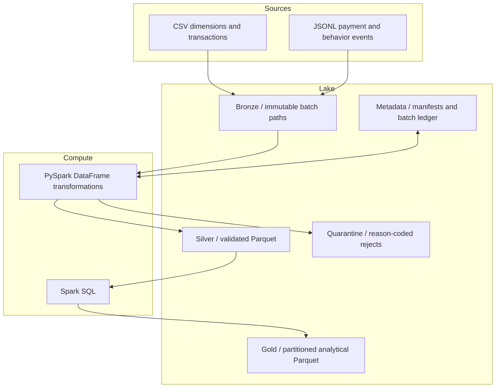

# Architecture and local resource plan

## Decision record

Phase 1 uses PySpark 3.5.9 in local mode with filesystem-backed storage. Local mode is the
smallest environment that executes actual Spark logical and physical plans. Docker supplies the
missing Java 17 and Python 3.11 runtimes and behaves consistently on ARM64 and x86-64 hosts.

Spark 4 is not required for the target concepts, while Spark 3.5 remains representative of many
managed Spark environments and has a mature Hadoop 3 integration line. The project can revisit
Spark 4 after the complete pipeline establishes a benchmark baseline.

## Logical data flow

Local storage will use `data/{bronze,silver,gold,quarantine,metadata}`. AWS mode will preserve the
same logical prefixes behind a configurable URI. Code should not encode bucket names.

## Proposed batch boundary

Each source delivery has a `source_batch_id` and manifest. Phase 2 will fingerprint input files
and register a batch before copying them into a unique Bronze path. Later phases will write to a
temporary batch path, validate expected outputs, and publish commit metadata only after success.
This provides safe reruns but is not called exactly-once processing.

Plain Parquet cannot atomically update rows across files. Phase 6 will document rewrite-based
handling and evaluate Iceberg only as an optional enhancement.

## Resource estimates

These are capacity-planning ranges, not measured benchmark results:

| Profile | Behavioral events | Suggested cores | Suggested container memory | Approx. working disk |
|---|---:|---:|---:|---:|
| Small | 10,000 | 2 | 2–3 GB | under 250 MB plus image |
| Medium | 100,000 | 2–4 | 3–4 GB | 0.5–1 GB plus image |
| Large | 1,000,000 | 4+ | 6–8 GB | 3–6 GB plus image |
| Stress | 5,000,000+ | hardware-dependent | 12 GB+ | 15 GB+ plus image |

The actual expansion depends on line-item multiplicity, Spark spill, file counts, and output
format. The current 8 GB host should remain on Small for normal development. Medium may be used
later with monitoring; Large and Stress should not run without explicit review.

## Failure domains to design for

- Truncated or malformed source files.
- Re-delivered files under a different filename.
- Partial writes and driver interruption.
- Duplicate events and dimension-key misses.
- Event-time lateness across batch boundaries.
- Skewed products or regions causing long-running shuffle partitions.
- Excessive small Parquet files.
- S3 request throttling, IAM denial, or network interruption in AWS mode.
