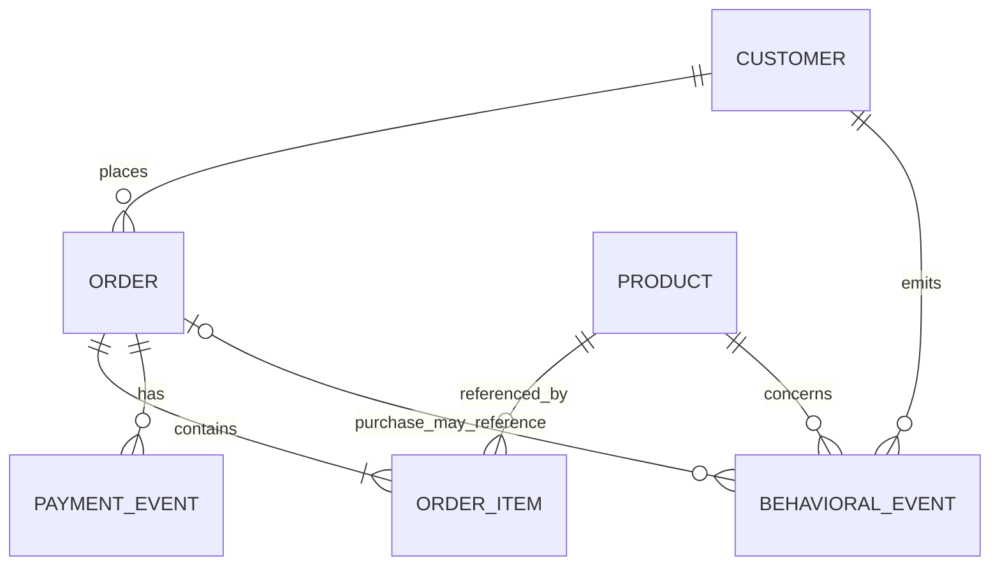

# Synthetic source data model

All data is synthetic. Timestamps are UTC ISO-8601 strings. Monetary source fields are decimal
strings so malformed values can be preserved before Silver typing.

## Relationships

## Source grains

### customers.csv

One row per synthetic customer. Fields: `customer_id`, `customer_segment`, `home_region`,
`created_at`, `source_batch_id`. No direct personal identifiers are generated.

### products.csv

One row per product. Fields: `product_id`, `category`, `unit_price`, `currency`, `is_active`,
`source_batch_id`.

### orders.csv

One row per order. Fields: `order_id`, `customer_id`, `order_ts`, `region`, `status`, `currency`,
`source_batch_id`. Status is `completed`, `cancelled`, or `refunded`.

### order_items.csv

One row per line item. Fields: `order_item_id`, `order_id`, `product_id`, `quantity`,
`unit_price`, `discount_amount`, `source_batch_id`.

### payment_events.jsonl

One synthetic payment event per order in Phase 1. Fields: `payment_id`, `order_id`,
`payment_event_type`, `amount`, `currency`, `event_ts`, `source_batch_id`.

### behavioral_events.jsonl

One row per event. Fields: `event_id`, `event_type`, `event_ts`, `received_at`, `customer_id`,
`session_id`, `product_id`, nullable `order_id`, `region`, `source_batch_id`. Event types are
`product_view`, `add_to_cart`, and `purchase`. A late event has a receipt time one to seven days
after event time; this is modeled data, not yet a processing watermark.

## Deliberate invalid records

The configured invalid rate independently injects unknown order customer IDs, negative line-item
prices, negative payment amounts, and either unknown event product IDs or unparseable event
timestamps. The manifest reports actual counts. Valid references remain internally consistent.

## Planned analytical grains

| Gold dataset | Grain | Core metric interpretation |
|---|---|---|
| `daily_revenue` | event date × region | accepted captured sales net of defined refunds |
| `product_performance` | product | units/revenue and rank among accepted orders |
| `customer_activity` | customer | accepted order frequency, spend, last purchase |
| `conversion_funnel` | region for a reporting window | event-count funnel, not unique-user conversion |
| `regional_sales` | region | revenue, distinct customers, accepted transactions |

Exact cancellation, refund, missing-data, and duplicate rules will be encoded and tested in
Phases 3–4 before these datasets are described as implemented.
